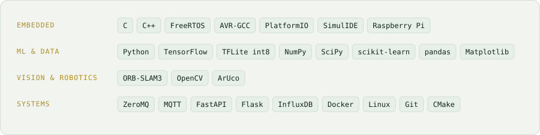

<picture>
  <source media="(prefers-color-scheme: dark)" srcset="assets/banner-dark.svg">
  
</picture>

Hi, I'm Anis, a 5th-year computer science engineering student at ESI Sidi Bel Abbès, Algeria. I build software that runs close to the hardware: microcontroller firmware, small ML models for microcontrollers, and robot navigation.

## Projects

<a href="https://github.com/LakhdariAnis/monocular-slam-navigation"><picture><source media="(prefers-color-scheme: dark)" srcset="assets/slam-dark.svg"></picture></a>
<a href="https://github.com/LakhdariAnis/tinyml-bearing-fault"><picture><source media="(prefers-color-scheme: dark)" srcset="assets/tinyml-dark.svg"></picture></a>
<a href="https://github.com/LakhdariAnis/Real-Time-Obstacle-Detection-Warning-System"><picture><source media="(prefers-color-scheme: dark)" srcset="assets/freertos-dark.svg"></picture></a>
<a href="https://github.com/LakhdariAnis/AVR-Dual-Node-Serial-Communication-System"><picture><source media="(prefers-color-scheme: dark)" srcset="assets/avr-dark.svg"></picture></a>

## Tools I use

<picture>
  <source media="(prefers-color-scheme: dark)" srcset="assets/tools-dark.svg">
  
</picture>

## Contact

lakhdarianisce@gmail.com · [linkedin.com/in/lakhdari-anis](https://www.linkedin.com/in/lakhdari-anis)
